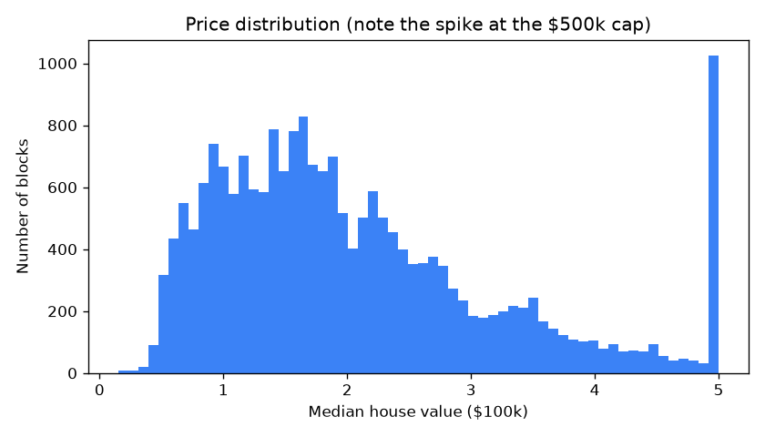
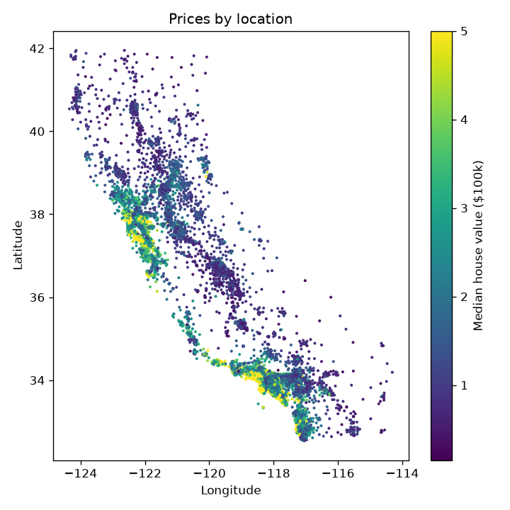
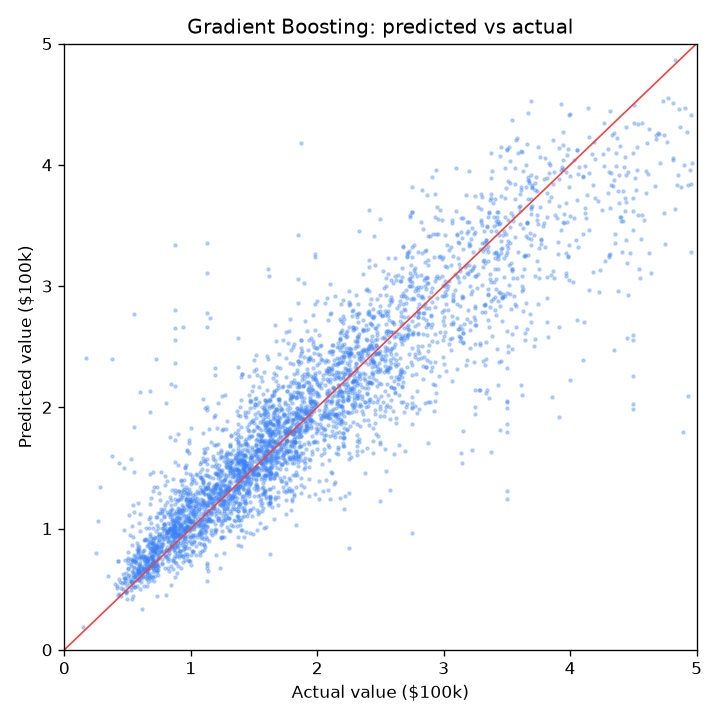
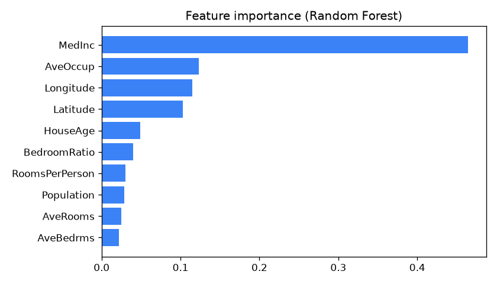

# California House Price Prediction

[](https://github.com/eslammohibrahim/california-housing/actions/workflows/tests.yml)

My first ML project: predicting house prices for California housing blocks from 1990 census data. I compared a linear regression baseline with two tree-based models.

## Data

The [California Housing dataset](https://scikit-learn.org/stable/datasets/real_world.html#california-housing-dataset) from the 1990 U.S. census: 20,640 housing blocks, 8 features (median income, house age, average rooms, population, location, ...), and the median house value as the target.

What I found while exploring:

- No missing values.
- 4.8% of blocks have their price capped at exactly $500k. The real value for these is unknown, so I removed them instead of letting the model learn a fake ceiling.
- Median income is by far the strongest single predictor (correlation 0.69 with price).
- Location matters a lot: coastal blocks around Los Angeles and the Bay Area are the most expensive.

| Price distribution | Prices by location |
|---|---|
|  |  |

## Approach

1. Clean: drop the capped blocks.
2. Feature engineering: add `RoomsPerPerson` and `BedroomRatio`, which describe a block better than raw averages.
3. 80/20 train/test split, plus 5-fold cross-validation on the training set to check the scores are stable.
4. Compare three models: Linear Regression (baseline), Random Forest, and Gradient Boosting.

## Results

Test set, 3,930 blocks:

| Model | MAE | RMSE | R² | CV R² (train) |
|---|---|---|---|---|
| Linear Regression | $44,551 | $60,324 | 0.620 | 0.613 ± 0.041 |
| Random Forest | $31,067 | $46,450 | 0.775 | 0.774 ± 0.006 |
| Gradient Boosting | $28,099 | $41,729 | 0.818 | 0.817 ± 0.009 |

Gradient Boosting is the best model: on average its prediction is about $28k away from the real value, and it explains about 82% of the variation in price. The cross-validation scores match the test scores closely, so the model isn't overfitting.

| Predicted vs actual | Feature importance |
|---|---|
|  |  |

The model is least accurate for expensive blocks, where there's less data and prices vary more.

## Run it

```bash
python -m venv .venv
.venv\Scripts\activate        # on macOS/Linux: source .venv/bin/activate
pip install -r requirements.txt

python src/explore.py   # stats + figures in reports/figures
python src/train.py     # trains the models, saves the best one to models/
python src/predict.py   # predicts the price for an example block
pytest                  # data pipeline tests (no download needed)
```

## Project structure

```
src/
  data.py      loading, cleaning, feature engineering, train/test split
  explore.py   exploratory analysis and figures
  train.py     model training, evaluation, and comparison
  predict.py   prediction with the saved model
tests/
  test_data.py cleaning, features and split
reports/
  figures/     generated plots
  results.json metrics for all models
```

## What I'd try next

- Tune Gradient Boosting's hyperparameters with a proper search.
- Add distance-to-coast and distance-to-major-city features.
- Serve the model behind a small API.
